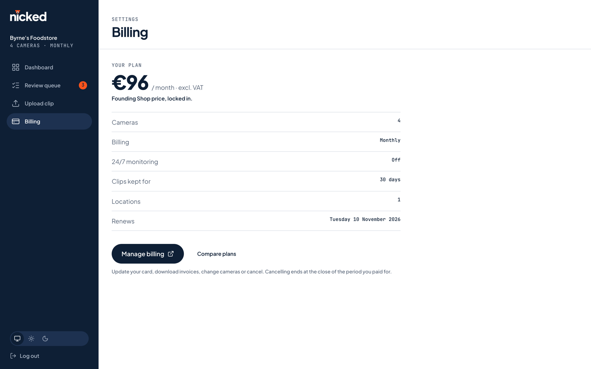
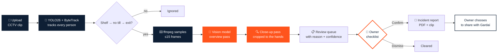

<div align="center">


# nicked

### Nicked? Now you'll know.

**AI that watches the CCTV a shop already has and flags the moments that look like concealment.**
**The owner watches those seconds and nothing else. Nothing goes to the Gardaí until they confirm.**

<br />

[](#-built-at-hackucd-2026)
[](#-my-part-the-frontend)
[](#-bring-your-own-api-keys)


<br />

<picture>
  <source media="(prefers-color-scheme: dark)" srcset="docs/screenshots/landing-dark.png" />
  
</picture>

</div>

<br />

> [!NOTE]
> There's no hosted demo. Clone the repo and run it on your own machine. The frontend works straight away on sample data. The full pipeline needs **your own** OpenRouter and Stripe keys: see [Bring your own API keys](#-bring-your-own-api-keys).

<br />

## 🎨 My part: the frontend

I'm **Daniel Omotayo**, and I designed and built the web app in [`frontend/`](frontend/). Nicked was a three-person team project: the backend and detector are credited in [Team & contributions](#team--contributions).

<table>
  <tr>
    <td width="50%"></td>
    <td width="50%"></td>
  </tr>
  <tr>
    <td align="center"><b>Review queue</b><br /><sub>Only the moments worth a look, ranked by confidence</sub></td>
    <td align="center"><b>Review a flag</b><br /><sub>Clip jumps to the flagged second; the owner answers the checklist</sub></td>
  </tr>
</table>

- **Every screen in the owner's flow:** landing page, pricing, sign-up, upload, analysis progress, dashboard, review queue, flag review, incident report, billing and checkout success.
- **React + TypeScript + Vite + Tailwind CSS**, styled from the Nicked brand guidelines: navy `#0E1F35`, Signal Orange `#FF541C`, Plus Jakarta Sans and JetBrains Mono.
- **Light and dark themes** that follow the system or a manual toggle, and a **fully responsive** layout with a mobile tab bar.
- **Keyboard-driven review:** `J` / `K` move through flags, `C` / `U` / `D` confirm, mark unsure or dismiss, and `←` / `→` skip 5 s in the clip.
- **Preview mode:** with no backend configured, the app runs on sample data, so anyone can click through it. With `VITE_LIVE=true`, the same screens talk to the real API.
- **Careful by design:** statuses are *Flagged · Confirmed · Cleared · Reported to Gardaí*. Signal Orange marks only the thing that needs a human, and the copy never accuses anyone. Every screen has designed loading, empty and error states.

<br />

## 💶 The pricing model

I designed the pricing around a small Irish shop with a handful of cameras. It's cheap to start, gets cheaper per camera as the shop grows, and charges only for the extras the owner picks.

<table>
  <tr>
    <td width="50%"></td>
    <td width="50%"></td>
  </tr>
  <tr>
    <td align="center"><b>Pricing</b><br /><sub>Live calculator showing every tier and add-on</sub></td>
    <td align="center"><b>Billing</b><br /><sub>The plan the owner is on, managed through Stripe</sub></td>
  </tr>
</table>

**Graduated per-camera tiers.** Each tier only prices the cameras inside it, so adding a camera never makes the earlier ones dearer.

| Cameras | Monthly | Yearly |
|---|---|---|
| 1–2 | **€29** each | €290 each |
| 3–4 | **€19** each | €190 each |
| 5+ | **€15** each | €150 each |

| Shop size | Per month |
|---|---|
| 1 camera | **€29** |
| 2 cameras | **€58** |
| 4 cameras | **€96** |
| 8 cameras | **€156** |

- 📅 **Yearly = 10 × monthly**, so paying yearly gets two months free.
- ➕ **Add-ons:** 24/7 monitoring €16 per camera · 90-day retention €5 · extra location €19 (per month).
- ⏱️ **Fair use:** each camera covers up to 12 hours of footage a day. Round-the-clock coverage is the 24/7 add-on.
- 🎁 **Free first scan:** one clip, up to an hour, no card.

The maths is in [`frontend/src/lib/pricing.ts`](frontend/src/lib/pricing.ts), and [`pricing.test.ts`](frontend/src/lib/pricing.test.ts) checks every example above. The backend charges the same tiers through Stripe Checkout, and Stripe's total is the final word.

<br />

## 🕵️ The problem

> **Something's gone. The footage is 11 hours long.**

Every corner shop, off-licence and pharmacy in Ireland already has CCTV. Almost none of them have time to use it. When stock walks out the door, the owner either scrubs through a full day of video or writes the loss off.

**Nicked does the scrubbing.** Upload a clip, and Nicked returns the handful of seconds worth a look: the time, the aisle, and *why* it looks off. The owner watches those, ticks a checklist, and decides.

<br />

## ⚡ How it works



| Step | What happens |
|---|---|
| **1. Track** | A Python service runs **YOLO26** with **ByteTrack** over the clip. **Supervision** zones mark the shelf, the till and the exit, judged at each person's feet. |
| **2. Shortlist** | Anyone who lingers at a shelf, never reaches the till, then heads for the exit becomes a *candidate*. Most of them are innocent browsers, and that's expected. |
| **3. Look** | ffmpeg pulls up to 15 frames from each candidate's window, and a vision model on **OpenRouter** answers `yes` / `no` / `unclear`, citing the exact frames it relied on. |
| **4. Look closer** | Promising moments get a second pass: dense frames around the key second, **cropped to the person** using the tracker's boxes. |
| **5. Decide** | The owner watches the flagged seconds and answers four questions. **Confirm needs a "yes" to all four.** |
| **6. Report** | A Garda-ready incident report: facts pulled from the database, key frames, a timeline, and an MP4 of the flagged window ±3 s. |

<br />

## 🖥️ More screens

<table>
  <tr>
    <td width="50%"></td>
    <td width="50%"></td>
  </tr>
  <tr>
    <td align="center"><b>Dashboard</b><br /><sub>Flags waiting, cameras, daily analysis budget</sub></td>
    <td align="center"><b>Incident report</b><br /><sub>Key frames, timeline, reference number, PDF download</sub></td>
  </tr>
  <tr>
    <td colspan="2" align="center"><br /><b>Upload</b><br /><sub>MP4 or MOV straight from the recorder</sub></td>
  </tr>
</table>

<details>
<summary><b>🌙 Dark mode</b></summary>
<br />
<table>
  <tr>
    <td width="50%"></td>
    <td width="50%"></td>
  </tr>
  <tr>
    <td colspan="2"></td>
  </tr>
</table>
</details>

<details>
<summary><b>📱 Mobile</b></summary>
<br />
<p align="center">
  
  &nbsp;
  
  &nbsp;
  
</p>
</details>

<br />

## 🤝 We flag. You decide.

Nicked points at moments. It never accuses anyone, and the code enforces that:

- 🧑‍⚖️ **The AI never contacts anyone.** The app can't send a report anywhere. The owner downloads it and records whether they shared it.
- ✅ **Confirm is earned.** Confirming a flag needs a "yes" to all four checklist questions: picked up an item, concealed it, passed the till, left the shop.
- 🧾 **Evidence or it didn't happen.** If the model says "yes" but cites no frame it was actually sent, the verdict is downgraded to `unclear` and flagged.
- 🗣️ **Careful words.** Reports are scanned for loaded language ("theft", "suspect", …), rewritten once, and flagged for the owner to edit if any remains.
- 🗑️ **Footage is personal data.** Clips auto-delete after 30 days unless they back an incident report.

<br />

## 🔑 Bring your own API keys

This repo ships **no keys**. Each part has a `.env.example` template, and real `.env` files are git-ignored. To run the full pipeline, sign up for these yourself:

| Service | Used for | Where to get it | Goes in | Without it |
|---|---|---|---|---|
| **OpenRouter** | Vision checks on each flag, incident report text | [openrouter.ai/keys](https://openrouter.ai/keys) (pay-as-you-go, a few euro of credit is plenty) | `OPENROUTER_API_KEY` | Flags still reach the queue, marked "AI check failed" |
| **Stripe** (test mode) | Checkout, subscriptions, billing portal | Stripe dashboard → Developers → API keys. Use the `sk_test_…` key; live keys are refused. | `STRIPE_SECRET_KEY` | Subscribe and checkout fail |
| **Stripe webhook secret** | Confirming payments | Printed by `stripe listen` (see below) | `STRIPE_WEBHOOK_SECRET` | Payments never unlock the shop |
| **MongoDB** | The database | Local MongoDB, or a free [Atlas](https://www.mongodb.com/atlas) cluster | `MONGODB_URI` | The backend can't start |

**No keys at all?** Run the frontend on its own (below). It's a full clickable preview on sample data, with no backend and no accounts.

<br />

## 🚀 Run it (Mac)

> **Demo URL:** **http://localhost:5173** once all three parts are running.

**Just want to look around?** The frontend has a built-in preview on sample data, with no backend or keys needed:

```bash
cd frontend && npm install && npm run dev        # → http://localhost:5173
```

### 0 · Prerequisites (once)

```bash
brew install node ffmpeg python@3.12 stripe/stripe-cli/stripe
brew tap mongodb/brew && brew install mongodb-community && brew services start mongodb-community
# If Homebrew says a formula is from an "untrusted tap": brew trust --formula <name it shows>, then re-run
```

### 1 · Detector: Python, port 8000

```bash
cd detector
python3 -m venv .venv && source .venv/bin/activate
pip install --index-url https://download.pytorch.org/whl/cpu torch torchvision   # CPU build, much smaller
pip install -r requirements.txt
python pick_zones.py <your-clip.mp4> ../backend/zones.json   # click shelf, till, exit (once per camera)
uvicorn server:app --port 8000                               # → http://localhost:8000/health
```

### 2 · Backend: Node, port 4000

```bash
cd backend
npm install
cp .env.example .env
```

Fill in `backend/.env` with **your own** keys:

```bash
OPENROUTER_API_KEY=sk-or-...           # openrouter.ai/keys
STRIPE_SECRET_KEY=sk_test_...          # Stripe dashboard → Developers → API keys (sandbox only)
DETECTOR_URL=http://localhost:8000     # leave empty to use the built-in mock detector
```

```bash
npm run stripe:seed     # once: creates the products and prices in your Stripe sandbox
npm test                # 60 tests, no network needed (needs ffmpeg)
npm run dev             # → http://localhost:4000/api/health
```

In a **second terminal**, forward Stripe webhooks, then copy the `whsec_…` it prints into `STRIPE_WEBHOOK_SECRET` in `backend/.env` and restart the backend:

```bash
stripe login
stripe listen \
  --events checkout.session.completed,checkout.session.async_payment_succeeded,invoice.paid,invoice.payment_succeeded,invoice.payment_failed,customer.subscription.created,customer.subscription.updated,customer.subscription.deleted \
  --forward-to localhost:4000/api/billing/webhook
```

### 3 · Frontend: React, port 5173

```bash
cd frontend
npm install
VITE_LIVE=true npm run dev     # → http://localhost:5173 (Vite proxies /api to :4000)
```

Open **http://localhost:5173**, subscribe with Stripe's test card `4242 4242 4242 4242` (any future date, any CVC), and upload a clip.

<details>
<summary><b>🪟 On Windows</b></summary>
<br />

- Install the prerequisites with `winget install OpenJS.NodeJS.LTS Gyan.FFmpeg Python.Python.3.12 Stripe.StripeCli MongoDB.Server`.
- Activate the detector's venv with `.venv\Scripts\activate` instead of `source .venv/bin/activate`.
- Use `copy .env.example .env` instead of `cp`.
- In PowerShell, start the live frontend with `$env:VITE_LIVE="true"; npm run dev`.

</details>

| Guide | |
|---|---|
| 🛠️ [Backend setup, API reference and event schema](backend/README.md) | MongoDB, OpenRouter, Stripe webhooks, every endpoint |
| 🎯 [Detector setup](detector/README.md) | Install, draw zones, run as a service |
| 🔌 [Detector ↔ backend contract](backend/docs/DETECTOR_CONTRACT.md) | Request and response shapes |
| ☁️ [Deploying (Vercel + worker)](docs/DEPLOY.md) | Site and API on Vercel, video analysis on a container |

<br />

## 🗂️ Project structure

```
nicked/
├── frontend/          React + Vite app: landing, pricing, dashboard, queue, review, reports
│   └── src/
│       ├── pages/     Landing · Pricing · Auth · Upload · Processing · Dashboard · Queue · EventReview · Report · Billing
│       ├── components/ brand · feed (clip player) · layout · ui
│       ├── api/       live store that talks to the backend
│       ├── demo/      preview store on sample data
│       └── lib/       pricing (+ tests) · formatting · hooks
├── backend/           Express + MongoDB API: routes, pipeline jobs, OpenRouter, Stripe, 60 tests
├── detector/          YOLO26 + ByteTrack + Supervision service, zone picker
├── api/               Vercel function entry (the Express app)
├── Dockerfile         API + detector worker for video analysis
└── docs/              Deploy guide and screenshots
```

<br />

## 🏆 Built at HackUCD 2026

Nicked was designed and built in a weekend at **HackUCD 2026**, University College Dublin, October 2026.

### Team & contributions

| | Area | What they built |
|---|---|---|
| **Daniel Omotayo** · [@Daniel298747](https://github.com/Daniel298747) | Frontend | React + TypeScript + Vite app: landing page, pricing, dashboard, review queue, flag review, incident reports, billing. Designed the pricing model. |
| **Brian Odeyale** · [@brianodeyale64](https://github.com/brianodeyale64) | Backend + APIs | Express + MongoDB API: clip upload, ffmpeg frame sampling, two-pass OpenRouter verification, detector client, review queue, confirm / dismiss, Garda incident reports, Stripe billing and per-camera pricing, the backend test suite |
| **Cormac Kildea** · [@cormackildea](https://github.com/cormackildea) | Python YOLO detector | YOLO26 + ByteTrack + Supervision detector service (FastAPI, `POST /detect` on :8000), zone picker, Vercel / Docker / Render deployment |

The full git history is kept, so every commit is still credited to whoever wrote it. The frontend reached the team repo through Cormac's pull request (#2), so git shows those files under his name. This copy also merges in my original frontend commit (`48ca4f4`), so it appears under my name too.

The team repo is at [brianodeyale64/nicked](https://github.com/brianodeyale64/nicked).

<br />

## 📜 Licence

The detector uses **Ultralytics YOLO (AGPL-3.0)**, which is why this repository is public. A commercial Nicked would need an Ultralytics Enterprise licence or a differently licensed model. Supervision is MIT; OpenCV is Apache-2.0; ffmpeg is LGPL.

<div align="center">
<br />

<br />
<sub><b>We flag. You decide.</b></sub>
</div>
