<div align="center">


# nicked

### Nicked? Now you'll know.

**AI that watches the CCTV a shop already has and flags the moments that look like concealment.**
**The owner watches those seconds and nothing else. Nothing goes to the Gardaí until they confirm.**

<br />

[](#-built-at-hackucd-2026)
[](#-we-flag-you-decide)
[](#-tested-like-it-matters)


<br />

<picture>
  <source media="(prefers-color-scheme: dark)" srcset="docs/screenshots/landing-dark.png" />
  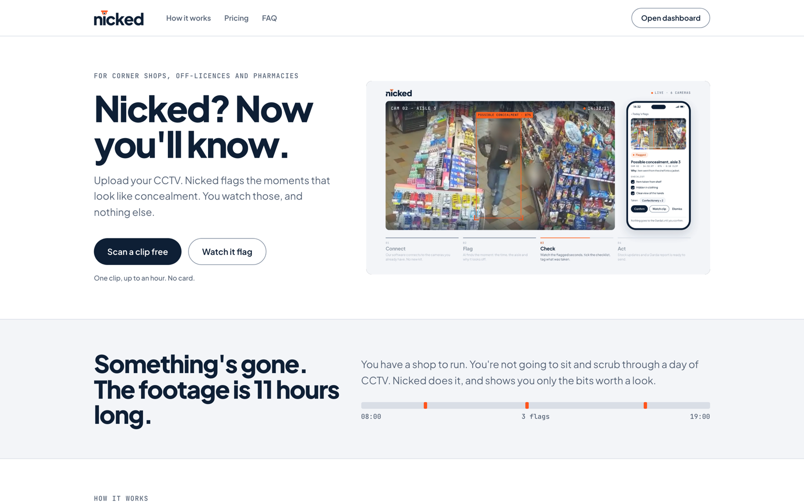
</picture>

</div>

<br />

## 🕵️ The problem

> **Something's gone. The footage is 11 hours long.**

Every corner shop, off-licence and pharmacy in Ireland already has CCTV. Almost none of them have time to use it. When stock walks out the door, the owner either scrubs through a full day of video or writes the loss off.

**Nicked does the scrubbing.** Upload a clip, and Nicked returns the handful of seconds worth a look: the time, the aisle, and *why* it looks off. The owner watches those, ticks a checklist, and decides.

<br />

## ⚡ How it works

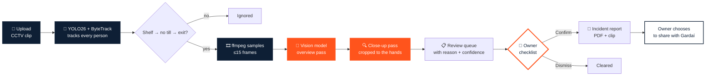

| Step | What happens |
|---|---|
| **1. Track** | A Python service runs **YOLO26** with **ByteTrack** over the clip. **Supervision** zones mark the shelf, the till and the exit, judged at each person's feet. |
| **2. Shortlist** | Anyone who lingers at a shelf, never reaches the till, then heads for the exit becomes a *candidate*. Most of them are innocent browsers, and that's expected. |
| **3. Look** | ffmpeg pulls up to 15 frames from each candidate's window, and a vision model on **OpenRouter** answers `yes` / `no` / `unclear`, citing the exact frames it relied on. |
| **4. Look closer** | Promising moments get a second pass: dense frames around the key second, **cropped to the person** using the tracker's boxes, so the model can actually see hands and pockets. |
| **5. Decide** | The owner watches the flagged seconds and answers four questions. **Confirm needs a "yes" to all four.** |
| **6. Report** | A Garda-ready incident report: facts pulled from the database, key frames, a timeline, and an MP4 of the flagged window ±3 s. |

<br />

## 🖥️ Screens

<table>
  <tr>
    <td width="50%">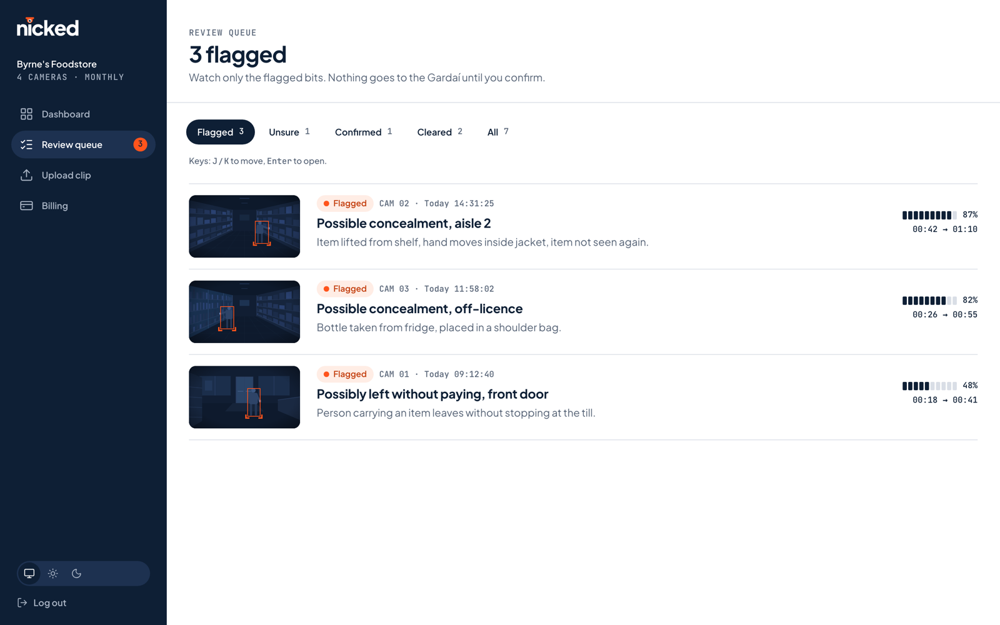</td>
    <td width="50%">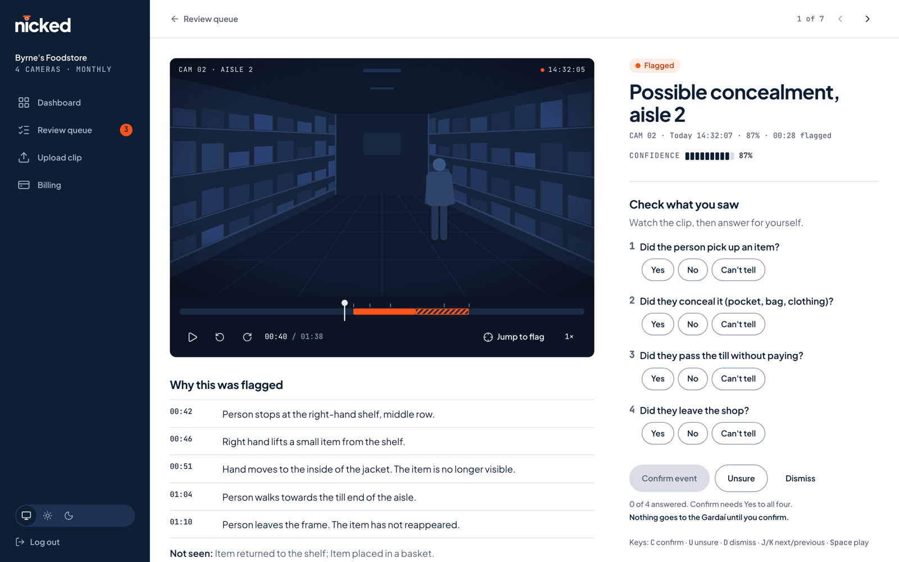</td>
  </tr>
  <tr>
    <td align="center"><b>Review queue</b><br /><sub>Only the moments worth a look, ranked by confidence</sub></td>
    <td align="center"><b>Review a flag</b><br /><sub>Clip jumps to the flagged second; the owner answers the checklist</sub></td>
  </tr>
  <tr>
    <td width="50%">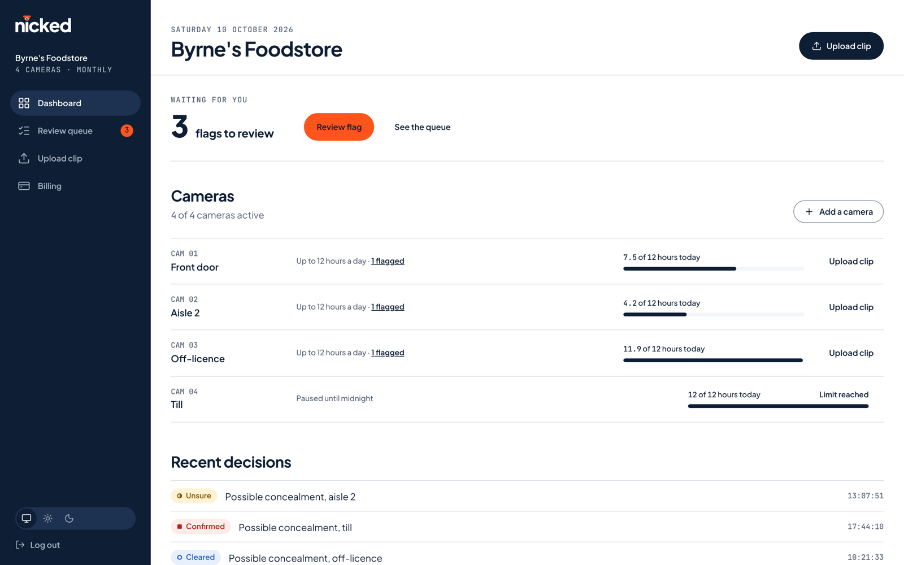</td>
    <td width="50%">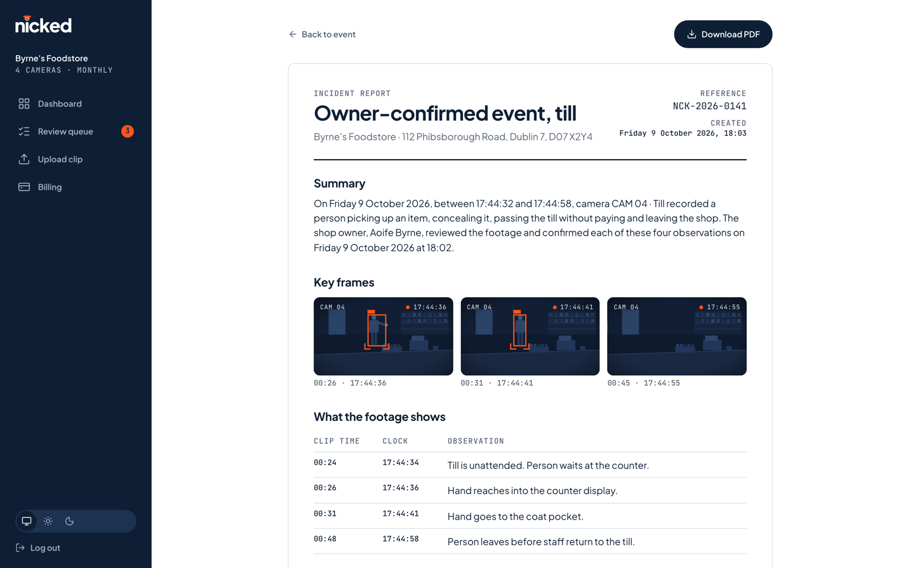</td>
  </tr>
  <tr>
    <td align="center"><b>Dashboard</b><br /><sub>Flags waiting, cameras, daily analysis budget</sub></td>
    <td align="center"><b>Incident report</b><br /><sub>Key frames, timeline, reference number, PDF download</sub></td>
  </tr>
  <tr>
    <td width="50%">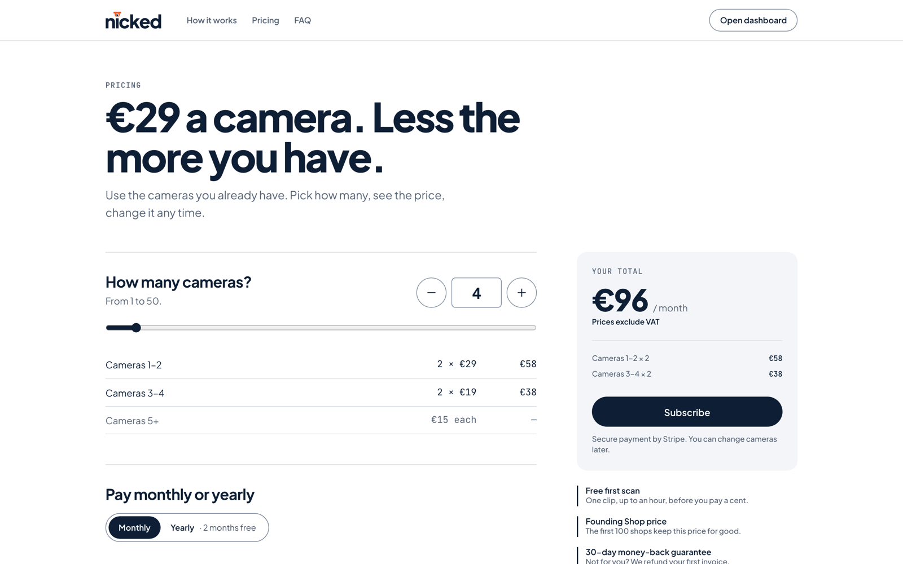</td>
    <td width="50%">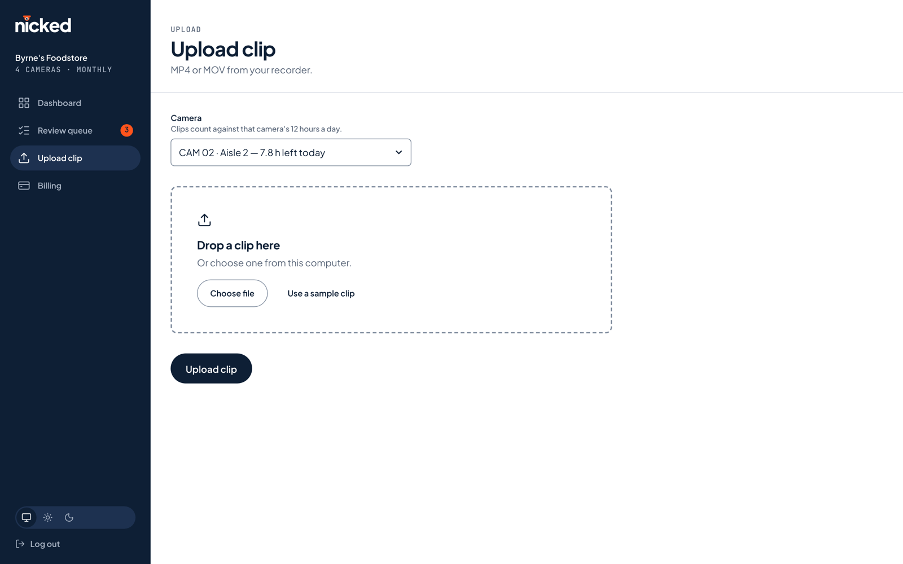</td>
  </tr>
  <tr>
    <td align="center"><b>Pricing</b><br /><sub>Per-camera, cheaper the more you have, paid through Stripe</sub></td>
    <td align="center"><b>Upload</b><br /><sub>MP4 or MOV straight from the recorder</sub></td>
  </tr>
</table>

<details>
<summary><b>🌙 Dark mode</b></summary>
<br />
<table>
  <tr>
    <td width="50%">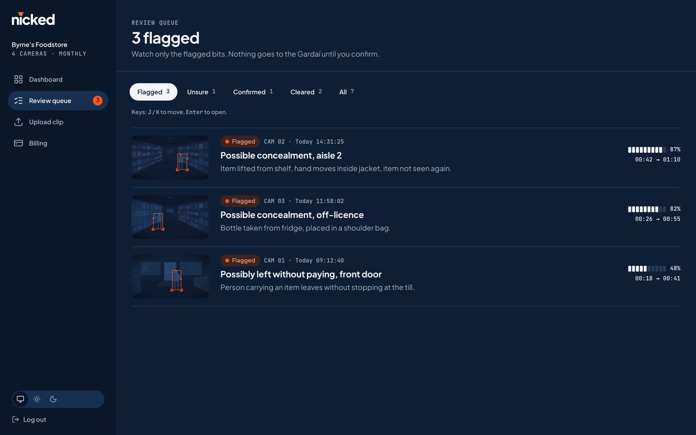</td>
    <td width="50%">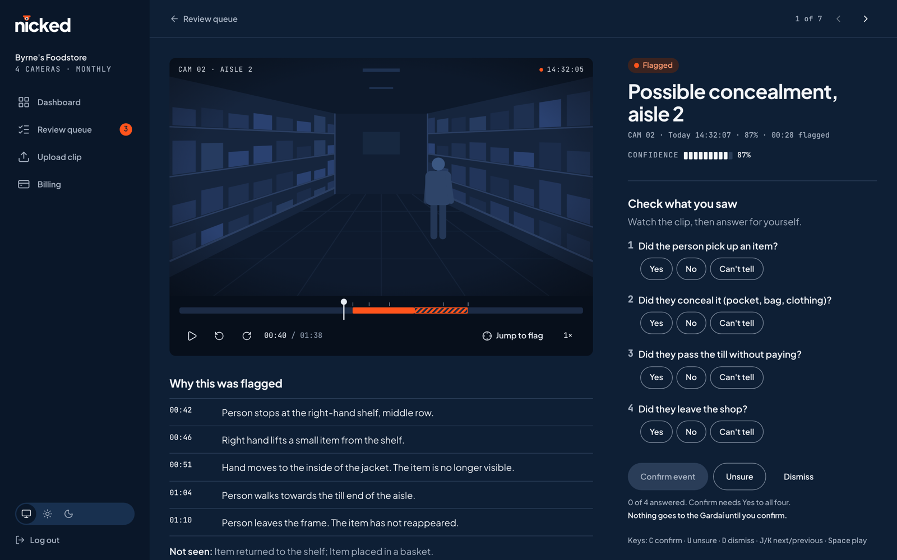</td>
  </tr>
  <tr>
    <td colspan="2">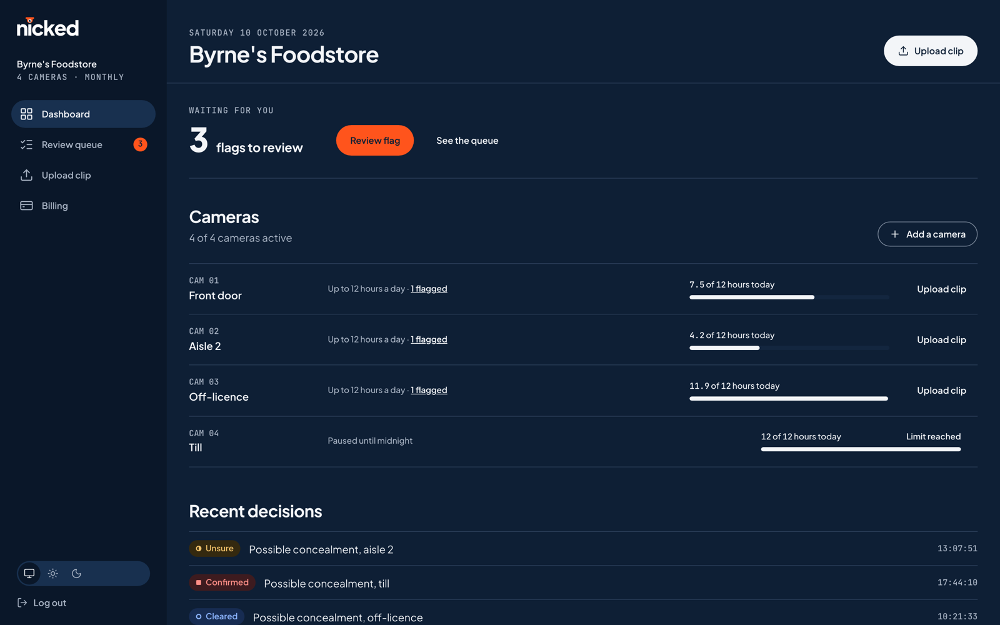</td>
  </tr>
</table>
</details>

<details>
<summary><b>📱 Mobile</b></summary>
<br />
<p align="center">
  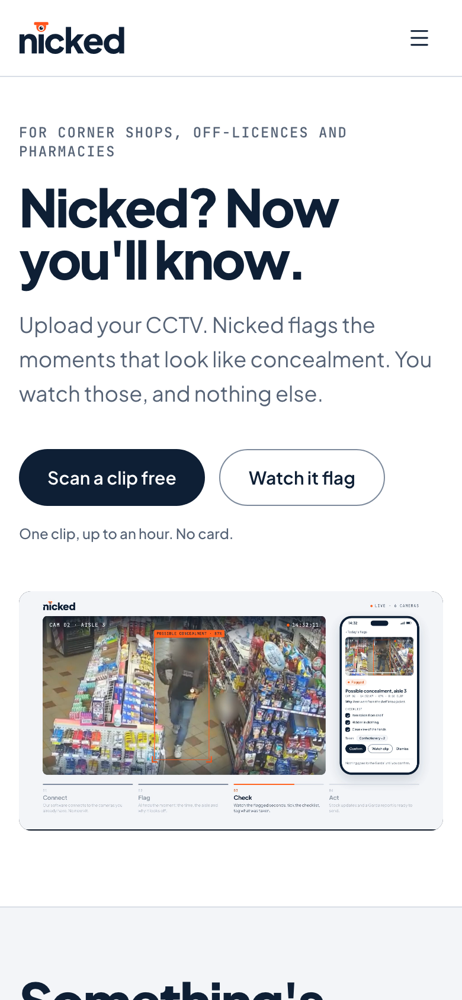
  &nbsp;
  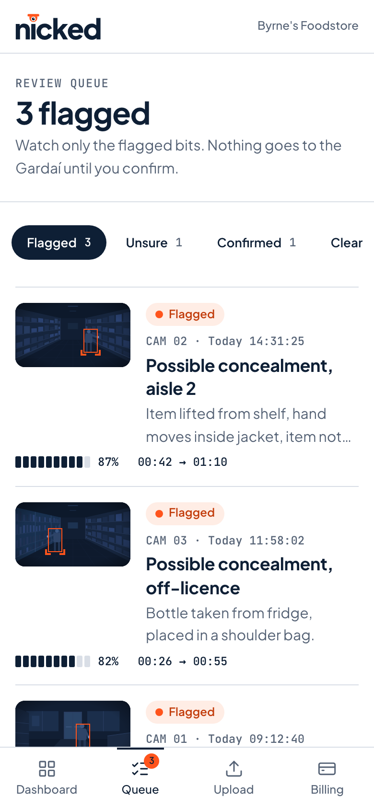
  &nbsp;
  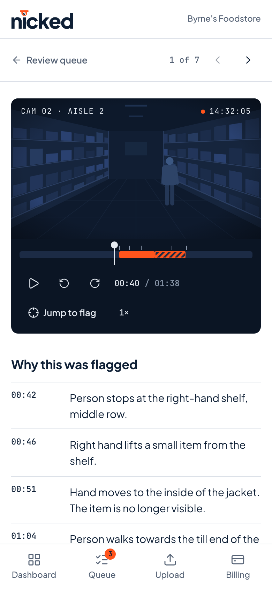
</p>
</details>

<br />

## 🤝 We flag. You decide.

Nicked points at moments. It never accuses anyone. That principle is enforced in the code, not just written on the landing page:

- 🧑‍⚖️ **The AI never contacts anyone.** The app can't send a report anywhere. The owner downloads it and records whether they shared it.
- ✅ **Confirm is earned.** Confirming a flag needs a "yes" to all four checklist questions: picked up an item, concealed it, passed the till, left the shop.
- 🧾 **Evidence or it didn't happen.** If the model says "yes" but cites no frame it was actually sent, the verdict is downgraded to `unclear` and flagged. Invented timestamps are thrown away.
- 🗣️ **Careful words.** Reports are scanned for loaded language ("theft", "suspect", …), rewritten once, and flagged for the owner to edit if any remains.
- 🙈 **AI "no" is hidden, not deleted.** Ruled-out candidates leave the queue but stay countable, so the false-alarm rate is visible.
- 🗑️ **Footage is personal data.** Clips auto-delete after 30 days unless they back an incident report.

<br />

## 🧠 Under the hood

<table>
<tr>
<td width="33%" valign="top">

### 🎯 Detector
`detector/` · Python

- Ultralytics **YOLO26** person detection
- **ByteTrack** multi-object tracking
- **Supervision** polygon zones
- `pick_zones.py`: click to draw zones per camera
- Returns person boxes ~5×/s and an **annotated video** with zones, IDs and boxes
- FastAPI service, one video at a time

</td>
<td width="33%" valign="top">

### ⚙️ Backend
`backend/` · Node

- **Express 5** + **MongoDB** (Mongoose)
- Background pipeline with live progress
- Two-pass vision check with **frame-citation validation** and a corrective retry on bad JSON
- Any vision model via **OpenRouter**, with cost tracked per check
- **Stripe** Checkout, graduated per-camera pricing, add-ons, idempotent webhooks
- Daily analysis caps, free first scan, 30-day retention job

</td>
<td width="33%" valign="top">

### 🎨 Frontend
`frontend/` · React

- **React** + **TypeScript** + **Vite**
- **Tailwind CSS**, light and dark themes
- Keyboard-driven review (`J`/`K`, `C`/`U`/`D`)
- Fully responsive with a mobile tab bar
- **Preview mode** on sample data with no backend needed

</td>
</tr>
</table>

<br />

## 💶 Pricing model

Built in and wired to a Stripe sandbox:

| Cameras | Monthly | Yearly |
|---|---|---|
| 1–2 | **€29** each | €290 each |
| 3–4 | **€19** each | €190 each |
| 5+ | **€15** each | €150 each |

**Add-ons:** 24/7 monitoring €16 · 90-day retention €5 · extra location €19 (per month).
**Free first scan:** one clip, up to an hour, no card. Four cameras = **€96/month**.

<br />

## 🚀 Run it

**Just want to see it?** The frontend has a built-in preview on sample data:

```bash
cd frontend && npm install && npm run dev      # → http://localhost:5173
```

**The full stack** (three terminals):

```bash
# 1 · detector
cd detector && pip install -r requirements.txt && uvicorn server:app --port 8000

# 2 · backend (needs MongoDB, plus OpenRouter + Stripe sandbox keys in backend/.env)
cd backend && npm install && cp .env.example .env && npm run dev    # → :4000

# 3 · frontend, talking to the real backend
cd frontend && VITE_LIVE=true npm run dev                           # → :5173
```

| Guide | |
|---|---|
| 🛠️ [Backend setup, API reference and event schema](backend/README.md) | MongoDB, OpenRouter, Stripe webhooks, every endpoint |
| 🎯 [Detector setup](detector/README.md) | Install, draw zones, run as a service |
| 🔌 [Detector ↔ backend contract](backend/docs/DETECTOR_CONTRACT.md) | Request and response shapes |
| ☁️ [Deploying (Vercel + worker)](docs/DEPLOY.md) | Site and API on Vercel, video analysis on a container |

<br />

## 🧪 Tested like it matters

`npm test` in `backend/` runs **60 tests** with no database or network: real ffmpeg on generated video, a local mock of OpenRouter, stubbed Mongo models, and **signed** Stripe webhooks.

| | Case | Result |
|---|---|---|
| ✅ | Model says "yes" and cites a real frame | Queued as possible concealment |
| ✅ | Model says "no" | Hidden from the queue, counted as a false alarm removed |
| ⚠️ | "Yes" with no frame it was actually sent | Downgraded to `unclear`, flagged |
| ⚠️ | Model invents timestamps | Ignored and flagged |
| ⚠️ | 33-second candidate | Sent as capped frames, not 66 |
| 🛑 | Malformed JSON | One corrective retry, then `error`, still queued for a human |
| 🛑 | Bad key / out of credits | AI checks stop early; candidates still reach the owner |
| 🛑 | Corrupt video, wrong type, too big | `422` / `415` / `413` with a readable message |
| 🛑 | Detector service down | `503` "Is the Python service running?" |
| 💳 | Duplicate Stripe webhook | Processed once, payment recorded once |

<br />

## 🗂️ Project structure

```
nicked/
├── frontend/          React + Vite app: landing, pricing, dashboard, queue, review, reports
├── backend/
│   ├── src/
│   │   ├── routes/    shop · billing · cameras · clips · events · incidents · stats
│   │   ├── services/  ffmpeg · detector · verify · crop · report · openrouter · stripe · pricing
│   │   ├── jobs/      processClip (pipeline) · retention · margin
│   │   └── models/    Shop · Camera · Clip · Event · Incident · AiCall · UsageDaily
│   ├── scripts/       seed-stripe · reset-demo-shop · list-vision-models · compare-models
│   └── test/          60 tests
├── detector/          YOLO26 + ByteTrack + Supervision service, zone picker
├── api/               Vercel function entry (the Express app)
├── Dockerfile         API + detector worker for video analysis
└── docs/              Deploy guide and screenshots
```

<br />

## 🏆 Built at HackUCD 2026

Nicked was designed and built in a weekend at **HackUCD 2026**, University College Dublin, October 2026.

| | Built |
|---|---|
| **Brian Odeyale** · [@brianodeyale64](https://github.com/brianodeyale64) | Backend: clip pipeline, two-pass AI verification, incident reports, Stripe billing and pricing engine |
| **Cormac Kildea** · [@cormackildea](https://github.com/cormackildea) | Frontend, YOLO detector service, Vercel and container deployment |

<br />

## 📜 Licence

The detector uses **Ultralytics YOLO (AGPL-3.0)**, which is why this repository is public. A commercial Nicked would need an Ultralytics Enterprise licence or a differently licensed model. Supervision is MIT; OpenCV is Apache-2.0; ffmpeg is LGPL.

<div align="center">
<br />

<br />
<sub><b>We flag. You decide.</b></sub>
</div>
